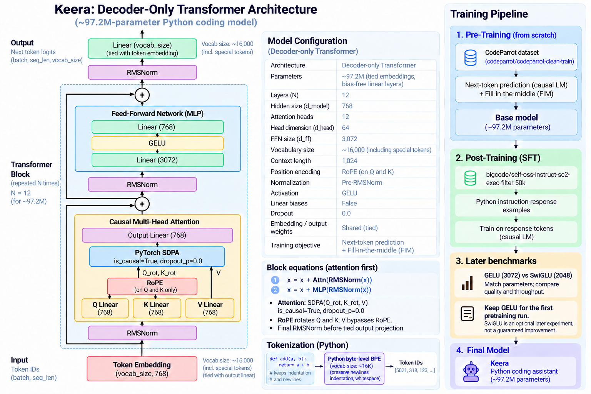

# Keera 0.0.1

## Coding Model
* Our idea is to build a model that has coding capablity only in python for now.
* We are using `codeparrot/codeparrot-clean-train` dataset for pretraining
* We are using `bigcode/self-oss-instruct-sc2-exec-filter-50k` dataset for posttraining
* We are thinking about decoder only transformer architecture,
* The size of model is around 100M parameters

## Purpose
* To learn the model building
* To scale the 100M model to large model
* To make useful coding model that's comparable to opus 5x
